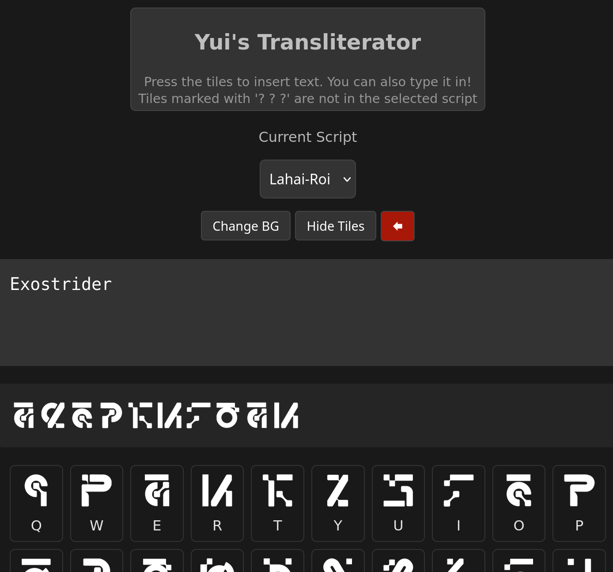

   

This tool is created for the purpose of transliterating in-game text.

Go to the live page: https://qubit69.github.io/ww-transliterator/

Features:
> Clickable, live tile grid 

> Different BG colors

> Scripts from 2 games, Wuthering Waves and PGR

-----
