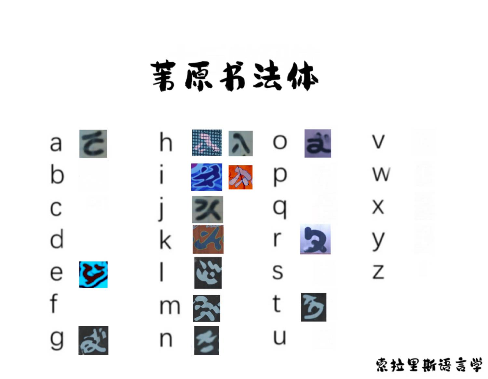
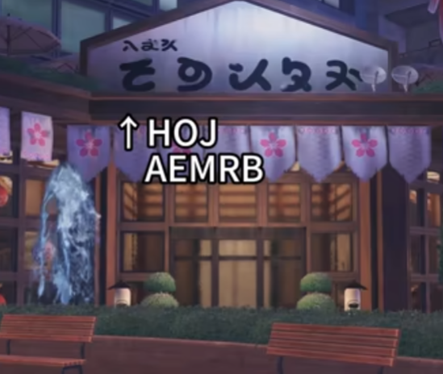
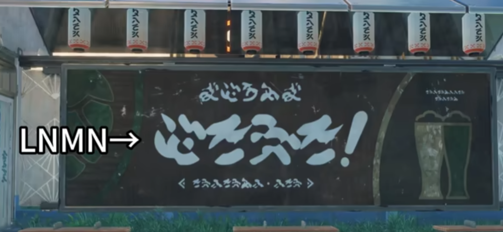
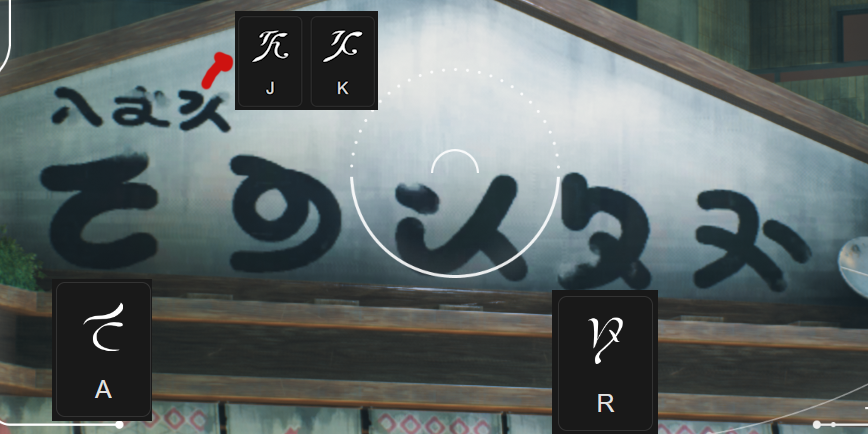
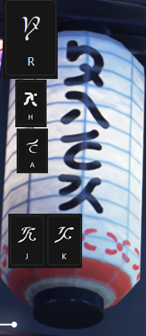
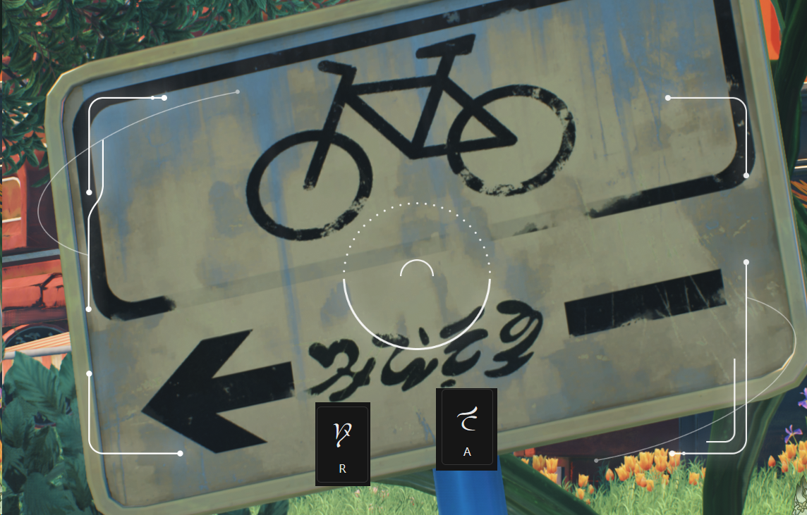

These are unlike other scripts. They are probably using Japanese meanings.

Also many characters are extremely distorted, making them hard to recognize/cross reference.
But they do share some similarities with others as shown below.

> A unknown author tried to decipher these to Latin.

|||
| --- | --- |
|  |  |
|  |  |

> Credit to **@.Syde**
||||
| --- | --- | --- |
|  |  |  |
| Some of these characters seem to match the **Ragunna** font. | A lantern found under some `shops` and `bus stops`. **H** seems to match **Septimont's** font. | According to .syde, this one might say `ROAD`. |
