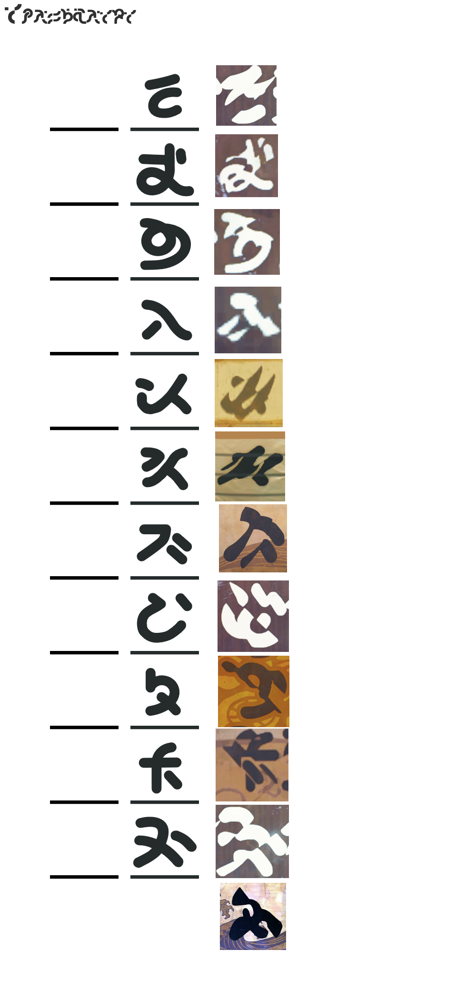

Unlike other scripts, these are not likely to mean anything

Also many characters are extremely distorted, making them hard to recognize/cross reference.
But they do share some similarities with others.

> Credit to **索拉里斯语言学** on [bilibili](https://www.bilibili.com/ja/video/BV1CfqeBhEaE/) **@ 0:49**

----

> Credit to **@.Syde**

`Reconstructed` characters

||||
| --- | --- | --- |
|  |  |  |
| Some of these characters seem to match the **Ragunna** font. | A lantern found under some `shops` and `bus stops`. **H** seems to match **Septimont's** font. | According to .syde, this one might say `ROAD`. |

